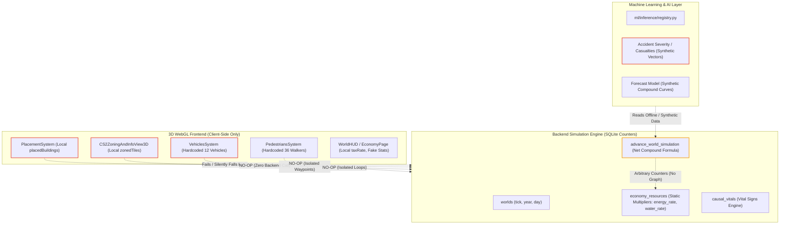

# GENESIS Engine: Master Coupling & Architecture Map

**Document Version:** 2.0.0 (Unified World Architecture Edition)  
**Date:** November 9, 2026  
**Status:** ARCHITECTURAL SPECIFICATION & SUBSYSTEM COUPLING MATRIX  

---

## 1. Before vs. Target Architecture Overview

### 1.1 Before Architecture: Decoupled & Siloed Layers

---

### 1.2 Target Unified Architecture: Single Source of Truth

```mermaid
flowchart TD
    subgraph Client3D["3D WebGL Command Center (View + Command Source)"]
        Tools["Build / Bulldoze / Zone / Road / Policy Tools"]
        Store["frontend/src/world/worldStore (Synced State by ID & Version)"]
        Renderer3D["Three.js Renderers (Instanced Buildings, Roads, Vehicles, Agents)"]
        HUD["HUD & InfoViews (Painted strictly from Synced State)"]
    end

    subgraph CommandGateway["Unified Command & Sync Gateway"]
        CmdEndpoint["POST /api/v1/worlds/{id}/commands (Batch, Idempotent, RBAC, Costs)"]
        SyncEndpoint["GET /api/v1/worlds/{id}/state (Authoritative Snapshot)"]
        ActionLog["GET /api/v1/worlds/{id}/action-log (Audit Trail & Undo Stack)"]
        WS["WebSocket /ws/world/{id} (Versioned Entity Deltas)"]
    end

    subgraph UnifiedWorld["Backend Unified World State & Simulation Engine"]
        WState["Authoritative WorldState (Entities with Stable IDs)"]
        RoadNet["Road Network Graph (A* Routing, Capacity, BPR Congestion)"]
        Utilities["Utility Graphs (Power Flow, Water Pressure, Outages)"]
        BuildingsZoning["Zoned Lots & Buildings (RCI Demand, Spawn, Abandonment)"]
        CitizensVehicles["Citizens & Vehicles (Schedules, OD Pairs, LOD Trips)"]
        DerivedSim["Deterministic Tick Order (All Metrics Derived from Graph)"]
    end

    subgraph AIEngine["Unified AI & Decision Engine"]
        FeatureExtractor["engine/world/features.py (Single Live State Extractor)"]
        RiskOverlays["Live Spatial Risk Scores (Blackouts, Traffic, Accidents)"]
        Counterfactuals["Branch Counterfactual Projections (Surrogate / Sim)"]
        AdvisorControl["Sandboxed Policy Recommendations (Guardrailed Commands)"]
    end

    %% Bidirectional Flows
    Tools -->|"Validated Commands"| CmdEndpoint
    CmdEndpoint -->|"Mutate Entities & Invalidate Caches"| WState
    WState -->|"Advance Tick"| DerivedSim
    DerivedSim -->|"Update Entities & Metrics"| WState
    WState -->|"State Version Deltas"| WS
    WState -->|"Full Snapshot"| SyncEndpoint
    WS -->|"Reconcile by Version"| Store
    SyncEndpoint -->|"Initial Load / Resync"| Store
    Store -->|"Render"| Renderer3D
    Store -->|"Display"| HUD
    CmdEndpoint -->|"Record Changes"| ActionLog

    %% AI Connections
    WState -->|"Authoritative Graph"| FeatureExtractor
    FeatureExtractor -->|"Live Features"| RiskOverlays
    FeatureExtractor -->|"Live Features"| Counterfactuals
    FeatureExtractor -->|"Live Features"| AdvisorControl
    RiskOverlays -->|"Overlays to View"| HUD
    AdvisorControl -->|"Propose Commands"| CmdEndpoint

    style Client3D fill:#1a241e,stroke:#2ecc71,stroke-width:2px;
    style CommandGateway fill:#1f2824,stroke:#3498db,stroke-width:2px;
    style UnifiedWorld fill:#1e261f,stroke:#f39c12,stroke-width:2px;
    style AIEngine fill:#251e2b,stroke:#9b59b6,stroke-width:2px;
```

---

## 2. Authoritative Tick Sequence Order

The unified simulation advances in a strict, deterministic sequence where each subsystem consumes the output of upstream stages and writes into the shared `WorldState`:

1. **Needs & Utilities:** Power and water flow across network graphs. Supply, demand, and shortages/outages computed per building node. Disconnected buildings lose operational efficacy.
2. **Environmental Quality:** Industrial emissions and road traffic diffuse into air pollution and noise fields.
3. **Public Health & Disease:** Shortages and pollution propagate into sickness and hospital admission queues.
4. **Incidents & Hazards:** Traffic volume and road types generate accidents; emergency dispatch routes vehicles via A*.
5. **Hospital & Emergency Response:** Hospitals admit patients up to capacity; bed occupancy determines mortality hazard.
6. **Mortality & Demographics:** Gompertz aging and hazard multipliers compute deaths by cause; Hadwiger fertility computes births.
7. **Economy & Labor Force:** Citizen schedules determine commutes; commercial/industrial buildings employ workers and generate tax revenue.
8. **Citizen Satisfaction & Happiness:** Commute times, noise, utility stability, and taxation determine citizen happiness.
9. **Unrest & Protests:** Low satisfaction and basic need deprivations trigger civil unrest and strikes.
10. **Governance & AI Feedback:** Policy edicts and AI advisor recommendations respond to state metrics.

---

## 3. Disconnect Map & Frontend-Logic-in-Wrong-Place List

The following client-side calculations, rules, validations, and state mutations have been audited and ranked by architectural impact for migration into backend authoritative modules:

| Rank | Impact Category | Client Location | Misplaced Operation | Target Backend Module (`engine/modules/`) |
| :--- | :--- | :--- | :--- | :--- |
| **1** | **CRITICAL: Simulation Desync** | `src/context/GameStateContext.tsx:1136-1145` | Real-time interval (`setInterval 1s`) computing deltas for food, water, energy, materials, research points, and GRC. | `engine/modules/resources.py` & `engine/modules/economy.py` |
| **2** | **CRITICAL: Ghost Entities** | `src/context/GameStateContext.tsx:1108` | `popGrowth = Math.round(...)` spawning client-only citizens without database entity IDs. | `engine/modules/population.py` |
| **3** | **HIGH: Economic Exploit** | `src/context/GameStateContext.tsx:1668, 2040, 2062` | Computing repair costs (`(100 - health) * 2.5`) and demolition refunds (`costMaterials * 0.8`) locally in browser state. | `engine/modules/infrastructure.py` (Command Gateway) |
| **4** | **HIGH: Unguarded Progression** | `src/context/GameStateContext.tsx:1153, 2204` | Client accumulating science points and unlocking Eureka 50% discounts without backend validation. | `engine/modules/progression.py` |
| **5** | **HIGH: Cosmetic Demand Curves** | `src/data/cs2Data.ts:220-230, 261-265` | RCI demand, water consumption, and traffic flow percentage computed from hardcoded client polynomials. | `engine/modules/infrastructure.py` & `engine/modules/movement.py` |
| **6** | **MEDIUM: Unguarded Policies** | `src/pages/PolicyLaboratoryPage.tsx:218-231` | Calculating GDP, happiness, and stability modifiers from slider inputs using client arithmetic. | `engine/modules/governance.py` |
| **7** | **MEDIUM: Client Achievement Claims**| `src/pages/MissionsPage.tsx:168`, `AchievementsPage.tsx:237` | Evaluating mission progress percentages and claiming rewards without backend proof validation. | `engine/modules/progression.py` (Atomic Ledger) |

