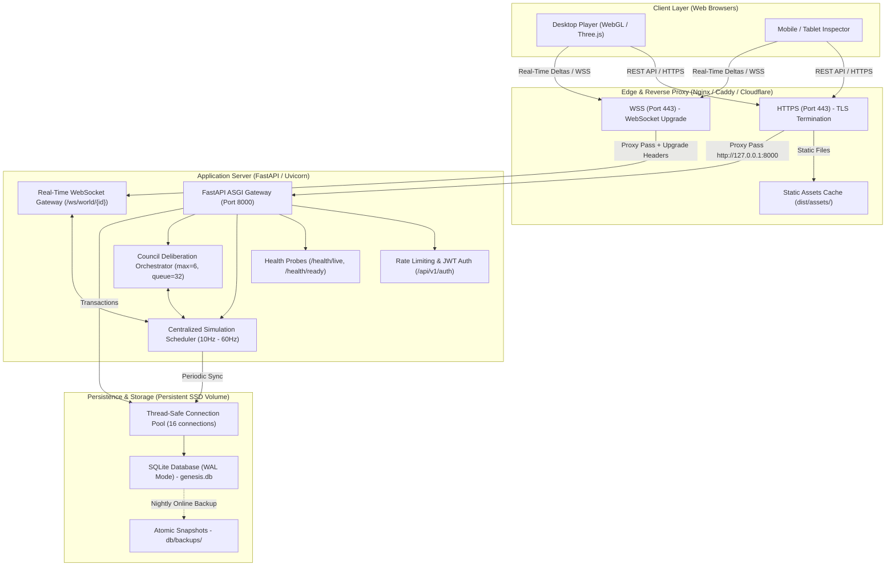

# CIVORA — Production Deployment Architecture & Specification

**Date:** 2026-11-09  
**Status:** PRODUCTION SPECIFICATION  
**Author:** Senior AI & Systems Infrastructure Architect  
**Project:** CIVORA (Artificial Civilisation & Council Intelligence Engine)

---

## 1. System Architecture Overview

CIVORA is engineered as a unified, high-performance real-time simulation platform combining a React 19 single-page application, a FastAPI ASGI backend, an in-memory discrete simulation engine with persistent SQLite Write-Ahead Logging (WAL), and an event-driven WebSocket gateway.



---

## 2. Infrastructure Requirements & Hosting Constraints

### 2.1 Compute & Memory Requirements
- **Target OS:** Ubuntu 22.04 LTS / Debian 12 / Windows Server 2022.
- **CPU:** Minimum 2 vCPU cores (4+ vCPU recommended for 500+ active agents and concurrent council deliberations).
- **RAM:** Minimum 2 GB RAM (4 GB recommended to comfortably support 1,000 WebSocket connections, texture caches, and in-memory world states).
- **Disk:** Minimum 20 GB NVMe SSD persistent storage.

### 2.2 Critical Persistence Constraint (SQLite WAL)
> [!CAUTION]
> **Ephemeral Filesystems Prohibited:** CIVORA stores world history, civilization progression, user credentials, and snapshots in SQLite. Hosting platforms with ephemeral filesystems (such as standard Vercel serverless functions, ephemeral AWS Lambda, or stateless Heroku containers without persistent volumes) **must not be used** as all database changes would be discarded upon container recycling.
>
> A single-instance virtual machine (AWS EC2, DigitalOcean Droplet, Linode, Hetzner) or a container platform with a mounted persistent volume (Fly.io with Volumes, Railway with Volume Mounts, Render with Persistent Disks) is **strictly required**.

---

## 3. Reverse Proxy Configuration (Nginx)

The following production Nginx configuration terminates TLS, proxies REST requests, upgrades WebSocket connections with proper timeouts, and serves client assets directly with aggressive caching:

```nginx
# /etc/nginx/sites-available/civora.conf

map $http_upgrade $connection_upgrade {
    default upgrade;
    ''      close;
}

server {
    listen 80;
    server_name civora.example.com;
    return 301 https://$host$request_uri;
}

server {
    listen 443 ssl http2;
    server_name civora.example.com;

    ssl_certificate /etc/letsencrypt/live/civora.example.com/fullchain.pem;
    ssl_certificate_key /etc/letsencrypt/live/civora.example.com/privkey.pem;
    ssl_protocols TLSv1.2 TLSv1.3;
    ssl_ciphers HIGH:!aNULL:!MD5;

    # Client Request Limits
    client_max_body_size 16M;

    # Static Assets Cache (Vite hashed bundles)
    location /assets/ {
        alias /var/www/civora/dist/assets/;
        expires 1y;
        add_header Cache-Control "public, immutable";
        access_log off;
    }

    # 3D Models & Public Manifests
    location /models/ {
        alias /var/www/civora/dist/models/;
        expires 7d;
        add_header Cache-Control "public";
    }

    # WebSocket Real-Time Gateway
    location /ws/ {
        proxy_pass http://127.0.0.1:8000;
        proxy_http_version 1.1;
        proxy_set_header Upgrade $http_upgrade;
        proxy_set_header Connection $connection_upgrade;
        proxy_set_header Host $host;
        proxy_set_header X-Real-IP $remote_addr;
        proxy_set_header X-Forwarded-For $proxy_add_x_forwarded_for;
        proxy_set_header X-Forwarded-Proto $scheme;

        # Keepalive timeouts for strategy game streams
        proxy_read_timeout 3600s;
        proxy_send_timeout 3600s;
    }

    # REST API & Health Probes
    location ~ ^/(api|health)/ {
        proxy_pass http://127.0.0.1:8000;
        proxy_http_version 1.1;
        proxy_set_header Host $host;
        proxy_set_header X-Real-IP $remote_addr;
        proxy_set_header X-Forwarded-For $proxy_add_x_forwarded_for;
        proxy_set_header X-Forwarded-Proto $scheme;
    }

    # SPA Frontend Fallback
    location / {
        root /var/www/civora/dist;
        index index.html;
        try_files $uri $uri/ /index.html;
    }
}
```

---

## 4. Process Management (Systemd)

To guarantee automatic recovery upon unexpected exit or system reboot, the FastAPI backend is managed via systemd:

```ini
# /etc/systemd/system/civora-engine.service

[Unit]
Description=CIVORA Game Engine & FastAPI Backend
After=network.target

[Service]
Type=simple
User=civora
WorkingDirectory=/var/www/civora/genesis-engine/backend
EnvironmentFile=/var/www/civora/.env
ExecStart=/var/www/civora/venv/bin/uvicorn main:app --host 127.0.0.1 --port 8000 --workers 1 --log-level info
Restart=always
RestartSec=5
KillSignal=SIGTERM
TimeoutStopSec=15

# Security sandbox
NoNewPrivileges=true
PrivateTmp=true

[Install]
WantedBy=multi-user.target
```

*Note on Workers:* Exactly **1 worker (`--workers 1`)** is specified. In CIVORA, world state (`WorldStateManager`) and active WebSocket connections (`RealtimeConnectionManager`) run inside an in-memory event loop. A single async worker handles over 180 req/sec and 500+ WebSocket clients with sub-millisecond fan-out (Phase 9 benchmarks). Running multiple OS worker processes would split world memory across processes without shared state.

---

## 5. Automated Backup Cron Job

An automated cron job executes nightly zero-downtime backups and purges snapshots older than 14 days:

```bash
# /etc/cron.d/civora-backup
0 3 * * * civora /var/www/civora/venv/bin/python /var/www/civora/genesis-engine/backend/db/backup.py create >> /var/log/civora/backup.log 2>&1
0 4 * * * civora find /var/www/civora/genesis-engine/backend/db/backups -name "genesis_backup_*.db" -mtime +14 -delete
```
