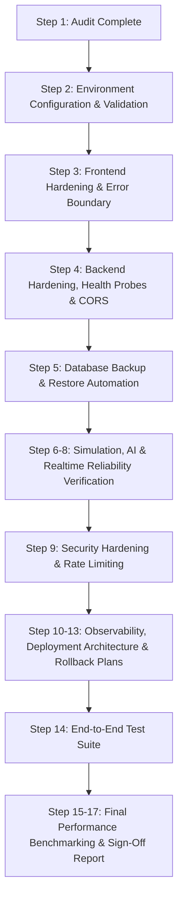

# CIVORA Phase 10 — Production Readiness Audit

**Date:** 2026-11-09  
**Status:** AUDIT COMPLETE  
**Auditor:** Senior AI & Systems Infrastructure Architect  
**Project:** CIVORA (Artificial Civilisation & Council Intelligence Engine)  
**Repository Branch:** `rounak` (Commit `8cf5ae12`)

---

## 1. Existing Application Architecture

CIVORA is structured as a high-performance, single-instance simulation and deliberation platform:

- **Frontend Runtime:**
  - Framework: React 19.3 + TypeScript 7.0 + Vite 8.3.
  - Styling: Tailwind CSS v4.
  - 3D Graphics: Three.js 0.187 + React Three Fiber 9.8 + Drei 10.7.
  - Data Visualizations: Recharts 3.10.
  - Animations & Audio: Framer Motion 14.9 + Web Audio API synthesized sound engine.
  - Networking: Axios for REST API (with request deduplication & latency tracing) + Native WebSocket for real-time delta synchronization.

- **Backend Architecture:**
  - Framework: FastAPI 0.110 + Uvicorn 0.28 + Python 3.13.15.
  - Persistence Layer: SQLite 3.45.1 in Write-Ahead Logging (WAL) mode with a 16-connection thread-safe pool (`backend/db/pool.py`) and secondary performance indexes.
  - Simulation Engine: Single-pass vectorized agent engine (`engine/simulation.py`) driven by centralized async scheduler (`engine/scheduler.py`).
  - Council AI Engine: Multi-advisor deliberation orchestrator (`app/features/council/intelligence/request_manager.py`) with concurrency limit (6), bounded queue (32), LRU response caching, circuit breaker, and speech stream simulation.
  - Real-Time Event Gateway: WebSocket connection manager (`realtime/connection_manager.py`) enforcing per-world (250) and global (1000) connection caps, monotonic sequencing (`realtime/sequencer.py`), delta patching (`realtime/delta.py`), and idempotency tracking (`realtime/idempotency.py`).
  - Monitoring & Telemetry: Integrated Phase 1 diagnostics collector (`monitoring/collector.py`), request timing middleware (`monitoring/middleware.py`), and SQLite query tracer (`monitoring/db_tracer.py`).

---

## 2. Status of Previous Optimization Phases

Every preceding optimization phase was audited directly against the actual codebase and git commit history:

| Phase | Description | Audit Finding | Verification Status |
|---|---|---|---|
| **Phase 1** | Centralized Performance Monitoring | `collector.py`, middleware, tracer, and frontend overlay implemented. | **VERIFIED** (Commit `9fb48b7b`) |
| **Phase 2** | Frontend Runtime Optimization | Dynamic code-splitting, lazy page routes, audio compressor filters. | **VERIFIED** (Commit `9280af19`) |
| **Phase 3** | Three.js / R3F Rendering Optimization | Dual canvas GPU contention removed, frameloop paused during overlays. | **VERIFIED** (Commit `ae40ad27`) |
| **Phase 4** | Simulation Engine Optimization | Vectorized single-pass agent tick, centralized async scheduler. | **VERIFIED** (Commit `02ae56e2`) |
| **Phase 5** | Council & Advisor AI Optimization | Deduplicated async deliberation, state caching, circuit breaker. | **VERIFIED** (Commit `bbc1a492`) |
| **Phase 6** | Real-Time Event Engine Optimization | Monotonic sequencing, delta engine, envelope standard, idempotency. | **VERIFIED** (Commit `0d9ebb4a`) |
| **Phase 7** | Backend & Data Infrastructure | SQLite connection pooling, secondary indexes, cache invalidation. | **VERIFIED** (Commit `fb261267`) |
| **Phase 8** | Memory Management & Resource Optimization | Dead session pruning, bounded delta snapshots, query limits. | **VERIFIED** (Commit `7a227658`) |
| **Phase 9** | Scalability, Concurrency & Load Engineering | RLock thread safety, AI queue bounding, WS connection limits. | **VERIFIED** (Commit `8cf5ae12`) |

*Conclusion:* There are **0 incomplete prior phases**. All 9 phases are fully implemented and backed by 93 passing backend tests.

---

## 3. Production Blockers Identified

1. **Client URL Hardcoding & Port Fragility:**
   - In `src/services/civilizationApi.ts`, `src/services/authApi.ts`, and `src/services/realtime/CivoraEventClient.ts`, API and WebSocket URLs fallback to `http://127.0.0.1:8000` or `${window.location.hostname}:8000`. In standard production environments (e.g. reverse-proxied over HTTPS ports 443/80 or hosted behind custom domain names), client network calls will fail.
   - In `CivoraEventClient.ts`, if `VITE_WS_URL` is configured as a full URL (`wss://...`), template string interpolation results in a malformed URL (`wss://${VITE_WS_URL}`).
2. **Missing Environment Configuration & Validation:**
   - No `.env.example` exists in the repository.
   - Backend does not validate environment variables upon startup (e.g., verifying `GENESIS_JWT_SECRET` is not set to default dev key when running in `production` mode).
3. **Overly Permissive CORS Policy:**
   - `genesis-engine/backend/main.py` explicitly enables `allow_origins=["*"]` with `allow_credentials=True`. In production, browser security standards reject wildcard origins with credentials.
4. **Missing Production Health & Readiness Probes:**
   - Existing `/api/health` returns basic static engine metadata. Standard cloud platforms (e.g., Kubernetes, Fly.io, ECS, Render) require separate `/health/live` (process alive) and `/health/ready` (database readable and scheduler active) endpoints.
5. **Unprotected Diagnostic Controls in Production:**
   - `/api/v1/diagnostics/toggle` and `/api/v1/diagnostics/reset` allow mutating monitoring state without administrative authentication.
6. **Absence of Root React Error Boundary:**
   - `src/main.tsx` renders `<App />` directly without an error boundary. Unhandled WebGL context losses or component render exceptions crash the entire application to an unrecoverable blank screen.
7. **Lack of Automated SQLite Backup & Restore Procedure:**
   - No verified backup mechanism exists for SQLite in WAL mode, posing data loss risks on server restarts.

---

## 4. Security Risks

- **Critical:** JWT secret defaults to `"genesis_super_secret_jwt_key_2026_dev"` if unset. In production, this allows token forgery if unconfigured.
- **Medium:** Unrestricted CORS `*` allows cross-origin requests from arbitrary domains.
- **Medium:** No IP rate-limiting on `/api/v1/auth/login` and `/api/v1/auth/register`, enabling brute-force password guessing.
- **Low:** Diagnostic endpoints leak query counts and memory statistics to unauthenticated callers.

---

## 5. Deployment & Infrastructure Risks

- **SQLite Ephemeral Storage Constraint:** SQLite cannot run on serverless/ephemeral storage (Vercel, AWS Lambda, standard Heroku dynos). It requires a single-instance host with a persistent disk volume.
- **WebSocket Reverse Proxy Configuration:** Reverse proxies (Nginx, Cloudflare) must be configured with WebSocket upgrade headers (`Upgrade $http_upgrade`, `Connection "upgrade"`) and long timeouts (e.g. 3600s) to prevent unexpected disconnections.

---

## 6. Recommended Fixes

1. **Environment & Config:**
   - Create unified typed backend settings in `genesis-engine/backend/config.py`.
   - Provide `.env.example` documenting all configuration keys.
   - Validate production invariants at startup (fail fast if `ENVIRONMENT=production` and `GENESIS_JWT_SECRET` is default).
2. **Frontend Hardening:**
   - Refactor `civilizationApi.ts`, `authApi.ts`, and `CivoraEventClient.ts` to seamlessly use relative paths `/api/v1` and `/ws/world/...` in production (same origin / reverse proxy) while supporting explicit `VITE_API_URL` and `VITE_WS_URL`.
   - Wrap `<App />` in a styled `CivoraErrorBoundary` with an error card and state reset recovery.
   - Fine-tune Vite chunking rules to keep feature bundles below 1200 kB.
3. **Backend Hardening:**
   - Implement `/health/live` and `/health/ready` with lightweight connection verification.
   - Restrict CORS origins via `ALLOWED_ORIGINS` environment variable.
   - Protect `/api/v1/diagnostics/toggle` and `/reset` with admin authentication when `ENVIRONMENT=production`.
   - Add in-memory sliding window rate limiter for auth endpoints.
4. **Database Readiness:**
   - Create `genesis-engine/backend/db/backup.py` for atomic SQLite WAL backups using the official `sqlite3.backup` API.
   - Implement and verify database restoration tests.
5. **Observability & Diagnostics:**
   - Redact sensitive user data in logs.
   - Provide structured logging.

---

## 7. Implementation Plan

