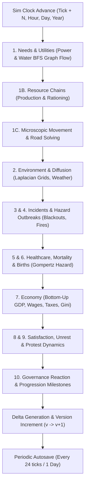

# GENESIS Simulation Engine: Architecture, Mathematical Models & Developer Guide

**Document Version:** 3.0.0 (Authoritative Unified Simulation Edition)  
**Date:** November 19, 2026  
**Audience:** Simulation Engineers, ML Engineers, Game Mechanics Developers  
**Target Repository Directory:** `genesis-engine/backend/engine/` and `src/world/`  

---

## 1. Executive Overview

The **GENESIS Simulation Engine** is an authoritative, agent-based socio-economic and urban physical simulation engine. It is designed around the core principle of **Single Source of Truth**:
- **Backend-Authoritative:** All simulation logic, demographic calculations, network physics, economic balances, and spatial diffusion happen deterministically on the backend (`AuthoritativeSimulationCore` and `UnifiedWorldSimulation`).
- **No Disconnected Random Counters:** World metrics (GDP, happiness, healthcare access, congestion, protest risk) are **strictly derived** from the state of physical entities (buildings, road graph, utility networks, citizen vectors).
- **Causal Consistency:** Interventions cascade deterministically across 10 discrete stages (e.g. cutting healthcare capacity directly increases mortality $\to$ decreases happiness $\to$ raises grievance $\to$ sparks protests).
- **Deterministic Replay:** Given an identical seed and initial command sequence, two simulations will produce bit-for-bit identical results.
- **Client Synchronization:** The frontend does not invent its own simulation numbers; it receives versioned snapshots and deltas over WebSocket (`/ws/world/{id}`) and displays them in Three.js and the UI HUD via `UnifiedWorldStore`.

---

## 2. Directory Sitemap & Component Map

The simulation code is organized across backend engines, subsystems, database layers, and frontend sync stores:

```
genesis-engine/backend/
├── engine/
│   ├── modules/                      # The 9 authoritative modular subsystems
│   │   ├── core.py                   # AuthoritativeSimulationCore (Orchestrates the 10-step tick loop)
│   │   ├── population.py             # CitizenAgent, Gompertz mortality, Hadwiger fertility, education
│   │   ├── resources.py              # 6 physical resource chains, consumption rates, rationing
│   │   ├── economy.py                # Bottom-up GDP, wages, taxation, debt, Gini coefficient
│   │   ├── infrastructure.py         # Utility graphs (Power/Water BFS), service coverage, road integration
│   │   ├── movement.py               # Microscopic traffic (IDM car-following, 4-phase signals, bus/pedestrians)
│   │   ├── environment.py            # 2D Laplacian diffusion (air/water smog), weather, seasonal cycles
│   │   ├── governance.py             # Public trust, grievance index, protest intensity, policy catalog
│   │   ├── events.py                 # Hazard engine (blackouts, epidemics, industrial fires, protests)
│   │   ├── progression.py            # Civilisation milestones, unlock gates, GRC rewards
│   │   └── future_sim.py             # Sandboxed 10-50 year counterfactual projections
│   ├── world/                        # Physical topology, spatial graphs, and command manager
│   │   ├── simulation.py             # UnifiedWorldSimulation (bridges world entities, roads & tick delta)
│   │   ├── state.py                  # Pydantic entity dataclasses (BuildingEntity, RoadSegment, Citizen, etc.)
│   │   ├── commands.py               # UnifiedCommandManager (batching, validation, RBAC, idempotency, undo stack)
│   │   ├── road_network.py           # Road graph, A* pathfinding, BPR travel time delays
│   │   ├── utility_network.py        # Power & water graph propagation, blackout identification
│   │   ├── map_topology.py           # Procedural masterplans & terrain elevation maps
│   │   ├── terrain_elevation.py      # Heightmap calculations
│   │   └── features.py               # UnifiedFeatureExtractor (converts live world graph into ML feature arrays)
│   ├── causal/                       # Causal Vital Signs DAG engine
│   │   ├── engine.py                 # CausalVitalsEngine (vital nodes, directed influence propagation)
│   │   └── state.py                  # Vital sign telemetry models
│   ├── cognitive.py                  # AI Dependency Paradox (Atrophy decay & Scaffolding friction math)
│   └── cs2_simulation.py             # Cities: Skylines II urban diffusion fields & zoning demand (RCI)
├── db/
│   ├── database.py                   # SQLite 3 WAL connection pool
│   └── schema.sql                    # Authoritative relational tables
└── tests/                            # Automated verification tests (228+ passing tests)

frontend/
├── src/
│   ├── world/                        # Frontend Authoritative State Sync
│   │   ├── worldStore.ts             # UnifiedWorldStore (Zustand: WebSocket sync, version reconciliation)
│   │   ├── movement/                 # MovementRenderer.tsx, useMovementSync.ts (interpolates vehicles)
│   │   └── types.ts                  # TypeScript interfaces mirroring backend entity dataclasses
│   └── simulation/                   # Legacy client-side modules (now bridged to worldStore)
```

---

## 3. The 10-Step Causal Tick Loop

The entire civilization evolves through `AuthoritativeSimulationCore.advance_tick(ticks=1)`. Each tick represents **1 hour of simulated time** (24 ticks = 1 simulated day; 365 days = 1 simulated year).

Every tick strictly executes in this deterministic 10-stage causal sequence:



### Detailed Breakdown of Each Step

#### Step 1: Needs & Utilities (`InfrastructureModule.step`)
- **Mechanism:** Builds a bipartite graph of power plants, water facilities, and consuming buildings.
- **Propagation:** Executes Breadth-First Search (BFS) along road and transmission corridors.
- **Outage Detection:** If total demand exceeds generator capacity ($\text{Demand} > \text{Supply}$), grid reliability drops and unpowered buildings become `status = "abandoned"` with zero operational efficiency.

#### Step 1B: Resource Chains & Rationing (`ResourcesModule.step`)
- **6 Physical Commodities:** Food, Water, Energy, Materials, Consumer Goods, and Research Points.
- **Consumption:** Every living citizen consumes baseline resources per hour ($0.08\text{ Food}$, $0.12\text{ Water}$, $0.05\text{ Energy}$).
- **Shortages:** If food or water stock reaches 0, rationing triggers health degradation and raises the unmet needs index.

#### Step 1C: Microscopic Movement & Commutes (`MovementModule.step`)
- **Trip Planning:** Pairs worker citizens with employment buildings and residential origins.
- **Routing:** Solves routes using congestion-weighted A* over `UnifiedRoadNetwork`.
- **Kinematics:** Updates active vehicle positions using the **Intelligent Driver Model (IDM)**, checks 4-phase traffic signals, gives right-of-way to emergency ambulances, and advances pedestrians along sidewalk splines.

#### Step 2: Environment & Spatial Diffusion (`EnvironmentModule.step`)
- **Smog & Pollution:** Simulates 2D Laplacian dispersion from industrial zones and high-congestion roadways.
- **Wind Vector Advection:** Plumes drift downwind across the terrain.
- **Seasonal Cycling:** Computes solar elevation and temperature based on `day_of_year`.

#### Steps 3 & 4: Incidents & Outbreak Detection (`EventsModule.step`)
- Evaluates stochastic event triggers conditioned on live stressors:
  - Food famine $\to$ Malnutrition crisis
  - Power blackout $\to$ Industrial plant shutdowns
  - High pollution $\to$ Respiratory illness spikes
  - High grievance $\to$ Civil protests and strikes

#### Steps 5 & 6: Hospital Care, Mortality & Births (`PopulationModule.step`)
- **Mortality:** Evaluates every citizen agent using the **Gompertz-Makeham Hazard Model**:
  $$\mu(x) = \alpha \cdot e^{\beta \cdot \text{age}} + \gamma_{\text{starvation}} + \gamma_{\text{dehydration}} + \gamma_{\text{pollution}} + \gamma_{\text{hospital\_deficit}}$$
- **Cause-Specific Logging:** Every death is recorded under an exact diagnostic category (`"Old Age"`, `"Starvation"`, `"Dehydration"`, `"Hospital Deficit"`, `"Pollution Exposure"`).
- **Fertility:** Hadwiger distribution centered at child-bearing ages ($18\text{--}40$), scaled by living space availability ($\text{Residential Capacity} - \text{Population}$) and family wealth.

#### Step 7: Bottom-Up Economy & Inequality (`EconomyModule.step`)
- **Macro GDP Calculation:** Sums enterprise output and citizen wages:
  $$\text{GDP} = C + I + G + (X - M)$$
- **Tax Collection:** Collects municipal revenue from residential, commercial, and industrial entities based on active tax rates.
- **Gini Inequality:** Calculates true Gini coefficient from the wealth distribution of all living agents:
  $$G = \frac{\sum_{i=1}^n \sum_{j=1}^n |w_i - w_j|}{2n \sum_{i=1}^n w_i}$$

#### Steps 8 & 9: Satisfaction, Unrest & Protests (`GovernanceModule.step`)
- **Non-Compensatory Unmet Needs:** Basic survival needs (food, water) cannot be offset by high entertainment:
  $$\text{Unmet Needs} = 0.70 \cdot \max(\text{Deficit}_{\text{food}}, \text{Deficit}_{\text{water}}) + 0.30 \cdot \text{Mean Deficits}$$
- **Public Grievance Index:** Compounded by unmet needs, unemployment, tax burden, and recent death rate.
- **Protest Ignition:** When $\text{Grievance} > 0.40$ and $\text{Public Trust} < 0.50$, protest intensity rises, reducing tax collection efficiency and blocking roads.

#### Step 10: Policy Reactions & Progression (`ProgressionModule.step`)
- Evaluates civilization level unlocks, quest completions, and awards Genesis Research Credits (GRC).

---

## 4. Key Mathematical Models & Formulas

### 4.1 The Cognitive Science Model (AI Dependency Paradox)
Defined in `engine/cognitive.py`, modeling how widespread automated AI without cognitive friction causes mental atrophy:

1. **Complacency Atrophy Decay:**
   $$\text{Atrophy} = (1.0 - \mathcal{S}) \cdot \beta_{\text{decay}} \cdot \mathcal{D}_t \cdot \Delta t$$
   Where $\mathcal{S} \in [0, 1]$ is the **Cognitive Scaffolding Friction** policy, and $\mathcal{D}_t \in [0, 1]$ is citizen AI dependency.

2. **Reasoning & Critical Evaluation Dynamics:**
   $$R_{t+1} = \max(0.1, \, R_t - \text{Atrophy})$$
   $$E_{t+1} = \max(0.1, \, E_t - \text{Atrophy})$$

3. **Macro Collective Innovation Index:**
   $$\mathcal{I}_{\text{macro}} = \frac{1}{N} \sum_{i=1}^N \left( 0.60 \cdot R_i + 0.40 \cdot (1.0 - \mathcal{D}_i) \right)$$
   High cognitive atrophy directly throttles scientific research speeds in the technology tree.

---

### 4.2 Traffic Flow: Bureau of Public Roads (BPR) Congestion
Defined in `engine/world/config.py` and evaluated in `road_network.py`:
$$t = t_0 \cdot \left( 1 + \alpha \left( \frac{V}{C} \right)^\beta \right)$$
- $t_0$: Free-flow traversal time ($\text{length} / \text{speed\_limit}$).
- $V$: Current vehicle volume on the road segment.
- $C$: Segment physical capacity in vehicles per hour ($\text{capacity\_vph}$).
- $\alpha = 0.15$, $\beta = 4.0$ (standard transportation engineering calibration).
- When $V > C$, travel time spikes exponentially, forcing the A* routing engine to divert trips to bypass avenues.

---

### 4.3 Intelligent Driver Model (IDM) Car-Following
Defined in `engine/modules/movement.py`:
$$\frac{dv}{dt} = a \left[ 1 - \left( \frac{v}{v_0} \right)^\delta - \left( \frac{s^*(v, \Delta v)}{s} \right)^2 \right]$$
Where the desired bumper-to-bumper dynamic gap is:
$$s^*(v, \Delta v) = s_0 + v T + \frac{v \Delta v}{2 \sqrt{a b}}$$
- $s_0 = 2.0\text{ m}$ (minimum standstill distance)
- $T = 1.2\text{ s}$ (safe time headway)
- $a = 1.5\text{ m/s}^2$ (maximum comfortable acceleration)
- $b = 2.0\text{ m/s}^2$ (comfortable deceleration limit)

---

### 4.4 2D Continuous Urban Diffusion Fields
Defined in `engine/cs2_simulation.py`:
$$\frac{\partial \phi}{\partial t} = D \nabla^2 \phi - \mathbf{v} \cdot \nabla \phi + S - \lambda \phi$$
- $\phi(x, y)$: Spatial concentration (e.g. industrial particulate smog, commercial noise, land value).
- $D$: Diffusion coefficient across adjacent 2D cells.
- $\mathbf{v}$: Planetary wind vector transporting plumes.
- $S$: Point sources (factories, highway intersections, parks).
- $\lambda$: Natural environmental decay / absorption rate.

---

## 5. Unified Command System & State Mutation

Every user action in the game (constructing a building, painting zoning, drawing roads, bulldozing, adjusting taxes) must pass through `UnifiedCommandManager` (`engine/world/commands.py`):

```
Frontend Tool Dispatch -> POST /api/v1/worlds/{id}/commands
   │
   ├── 1. Validation & Affordability Check (Sufficient Credits & Materials)
   ├── 2. Spatial Graph Check (No Collisions, Road Proximity, Slope Limits)
   ├── 3. RBAC Enforcement (Player vs Admin Permissions)
   ├── 4. Atomic Execution & State Mutation (Updates in-memory entities & SQLite)
   ├── 5. Invalidation & Cache Reset (Signals utility graphs & road graphs to rebuild)
   ├── 6. Action Log Recording & Undo Push (Allows Ctrl+Z rollback with 70% refund)
   └── 7. Returns CommandResult { success, entity_id, cost_deducted, version }
```

### Invariants Maintained by Commands:
- **70% Bulldoze Refund:** Demolishing structures reclaims exactly $70\%$ of material costs and credits.
- **Zero Negative Balance:** If player credits or materials are insufficient, the command is rejected with an explicit error code.
- **Undo Idempotency:** Rolling back an action reverses state mutations and restores refunded balances atomically.

---

## 6. How to Develop, Run, and Test the Simulation

### 6.1 Running the Backend Simulation Test Battery
All 185+ backend tests can be run via pytest in the virtual environment:

```bash
cd genesis-engine/backend
./venv/bin/pytest tests/ -v
```

To run targeted simulation tests:
```bash
# 1. Authoritative core & intervention tests (blackouts, hospital ablation, famine cascade)
./venv/bin/pytest tests/test_v2_authoritative_simulation.py -v

# 2. Causal vital signs and propagation DAG
./venv/bin/pytest tests/test_sim_causal_coupling.py -v

# 3. Microscopic vehicle & pedestrian kinematics
./venv/bin/pytest tests/test_gate2_movement_logic.py -v

# 4. CS2 depth (road graphs, diffusion fields, zoning demand)
./venv/bin/pytest tests/test_cs2_simulation_depth.py -v

# 5. Cognitive atrophy and AI dependency math
./venv/bin/pytest tests/test_cognitive.py -v
```

### 6.2 Running the 365-Tick Live Stability & Honesty Benchmark
To verify that the simulation runs without memory leaks, NaN drifts, or demographic mismatches over an entire simulated year:

```bash
cd genesis-engine/backend
./venv/bin/python3 -c "
from engine.modules.core import AuthoritativeSimulationCore
import time

sim = AuthoritativeSimulationCore('benchmark_run', seed=42)
t0 = time.perf_counter()
for tick in range(1, 366):
    delta, metrics = sim.advance_tick(1)
    if tick % 50 == 0:
        print(f'Tick {tick:3d}/365 | Pop: {metrics.population} | GDP: \${metrics.gdp:,.2f} | Happiness: {metrics.average_happiness:.2f}')
elapsed = time.perf_counter() - t0
print(f'365 Ticks completed in {elapsed:.3f}s ({365/elapsed:.1f} ticks/s)')
"
```

---

## 7. Rules & Best Practices for Modifying the Simulation

When implementing new simulation features, you must follow these architectural rules:

1. **Never Create Disconnected Random Counters:**
   Every metric must have a physical causal origin. If you add "Crime Rate", it must depend on unemployment, police station road coverage, and poverty, not a random walk.
2. **Preserve the 10-Step Causal Order:**
   Always place new subsystem calculations in their logical causal position in `AuthoritativeSimulationCore.advance_tick()`. Do not calculate citizen happiness before evaluating hunger and blackouts.
3. **Respect Deterministic Seeded PRNG:**
   Always use `self.rng` (passed from `get_seeded_rng(seed)`), never raw `random.random()`. Raw randomness breaks reproducible replay testing.
4. **Maintain Database & Snapshot Invariants:**
   - Population must always equal the count of living citizens: `len([c for c in citizens.values() if c.is_alive == 1])`.
   - Resources must never fall below `0.0`.
   - Gini coefficient must remain strictly bounded in $[0.0, 1.0]$.
5. **Separate Scientific Simulation from Game Progression:**
   GRC credits and research progression grant access to experiments and policies; they must **never** artificially distort physical simulation outcomes (e.g. paying credits cannot magically make citizens stop needing food).
6. **Keep WebGL Frontend Synchronized via Deltas:**
   When adding a new entity property that the 3D world needs to render, update `WorldStateDelta` and `DerivedCityMetrics` in `state.py`, and mirror the TypeScript interface in `src/world/types.ts`.
